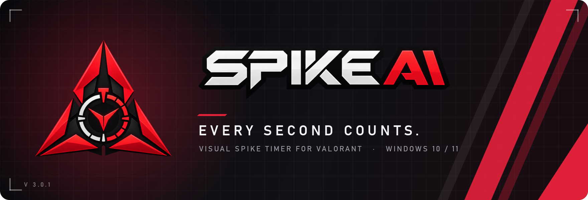
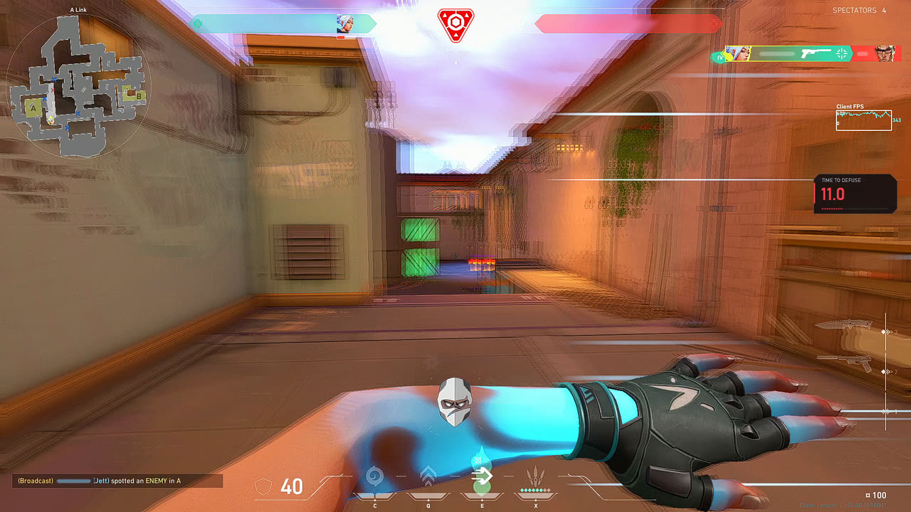
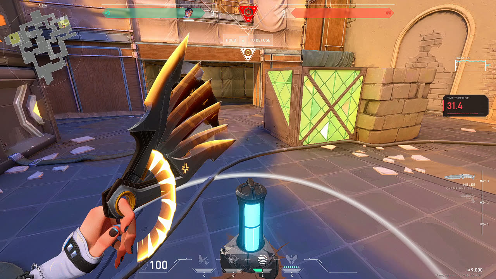
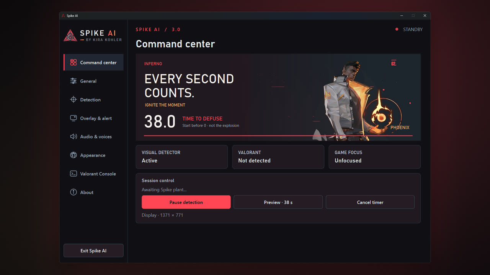
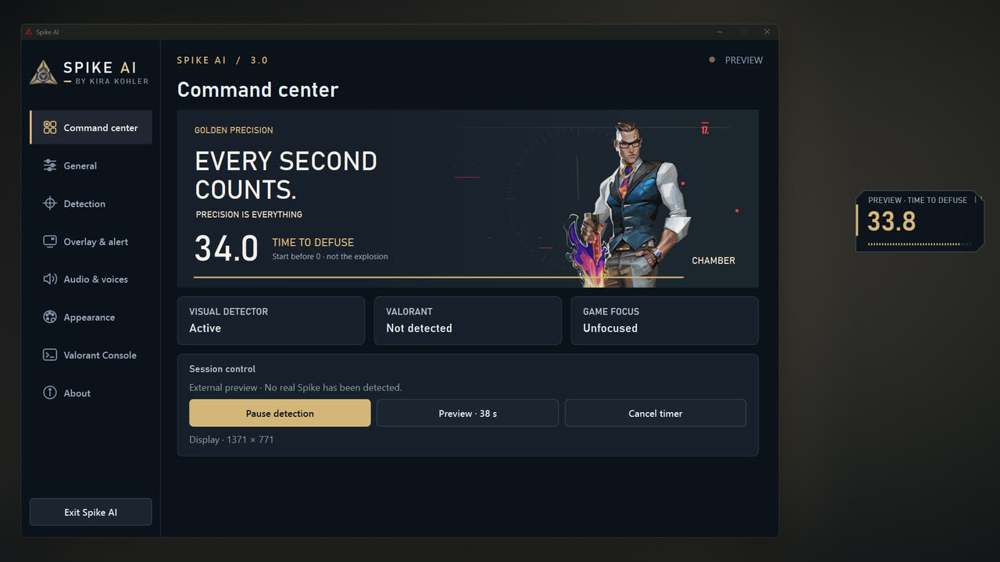
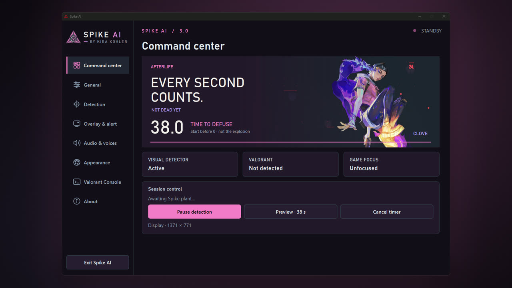
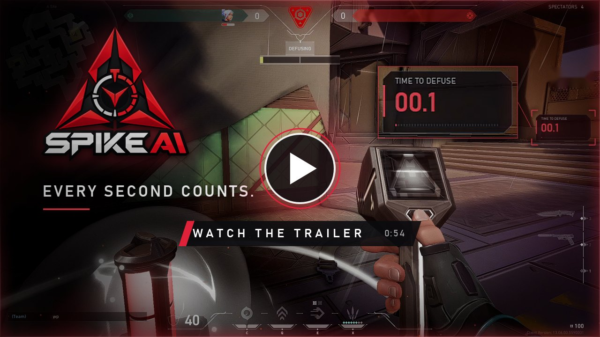

<div align="center">

<a href="https://apps.microsoft.com/detail/9p00fj06d2fc">
  
</a>

<br>
<br>

<a href="https://apps.microsoft.com/detail/9p00fj06d2fc"></a>
<a href="https://www.python.org/downloads/release/python-3119/"></a>
<a href="spikeai/__init__.py"></a>
<a href="LICENSE"></a>

### The planted Spike, timed to the last possible defuse.

SpikeAI recognises the planted Spike on your screen and counts down the time you have left to **start** a full defuse, with voice callouts and a red perimeter warning for the final seconds.

<br>

<a href="https://apps.microsoft.com/detail/9p00fj06d2fc">
  <picture>
    <source media="(prefers-color-scheme: dark)" srcset="https://get.microsoft.com/images/en-us%20light.svg">
    
  </picture>
</a>

<sub><b>Get SpikeAI on Microsoft Store</b> &nbsp;·&nbsp; free &nbsp;·&nbsp; Windows 10 (1809) or later, x64</sub>

<br>
<br>

[Overview](#overview) &nbsp;·&nbsp; [Features](#features) &nbsp;·&nbsp; [Gallery](#gallery) &nbsp;·&nbsp; [Trailer](#trailer) &nbsp;·&nbsp; [Install](#install) &nbsp;·&nbsp; [Build from source](#build-from-source) &nbsp;·&nbsp; [How it works](#how-it-works) &nbsp;·&nbsp; [License](#license-and-attribution)

</div>

<p align="center"></p>

## Overview

SpikeAI is a desktop companion for VALORANT on Windows. When the planted-Spike icon appears in the game's HUD, it starts a **38-second countdown** without any input from you, and tells you when the window to save the round is closing.

> [!IMPORTANT]
> **The countdown is not the explosion timer.** The Spike detonates 45 seconds after it is planted and a full defuse takes 7 seconds. SpikeAI's clock reaches **0** at the approximate latest moment a full defuse can still **begin** and finish in time. Start defusing before it hits zero.

The timer is approximate: it starts when SpikeAI sees the icon on screen, so it inherits the small delay between the plant and its detection.

<p align="center"></p>

## Features

| Feature | What it does |
|---|---|
| **Automatic Spike detection** | Watches the display that shows VALORANT and recognises the planted-Spike HUD icon, confirming it across consecutive frames before the clock starts. |
| **Countdown overlay** | A compact, always-on-top timer that lets clicks pass through. Size, opacity and position are adjustable, with a live on-screen preview. |
| **Voice callouts** | "Starting timer", then 20, 10 and 5 seconds left. Each callout can be switched off or replaced with your own WAV file. |
| **Perimeter warning** | A red glow around the screen edge for the final seconds. Trigger time, intensity, opacity, thickness, colour and pulse speed are configurable. |
| **Global hotkeys** | Start a timer with <kbd>F7</kbd> and cancel it with <kbd>F8</kbd>. Both keys can be changed. |
| **Auto-cancel** | The timer stops after the Spike icon has been missing for 5 seconds while the game has focus. Can be turned off. |
| **Detection controls** | Choose the display, pause detection, run a 38-second preview and read live detector, game and focus status from the Command center. |
| **Launch with Windows** | Optional, off by default, and can start minimized to the notification area. |
| **System tray** | Closing the window keeps SpikeAI running in the notification area; right-click the icon to exit. |
| **Eight themes** | Phoenix, Reyna, Viper, Neon, Chamber, Clove, RGB and Obsidian restyle the whole interface. |
| **Valorant Console** | A built-in viewer for VALORANT's own log file on your PC. |

<p align="center"></p>

## Gallery

<p align="center">
  
  <br>
  <sub>A real round: the countdown stays in view while you fight.</sub>
</p>

<p align="center">
  
  
  <br>
  <sub>The floating timer next to the planted Spike &nbsp;·&nbsp; Command center, Phoenix theme</sub>
</p>

<p align="center">
  
  
  <br>
  <sub>Chamber theme with the built-in preview running &nbsp;·&nbsp; Clove theme</sub>
</p>

<p align="center"></p>

## Trailer

<p align="center">
  <a href="https://kirakohler.com/cdn/player/spikeai">
    
  </a>
  <br>
  <sub><b>Watch the trailer</b> &nbsp;·&nbsp; 54 s of real VALORANT gameplay with SpikeAI running &nbsp;·&nbsp; 1080p, opens the SpikeAI player on kirakohler.com</sub>
</p>

<p align="center"></p>

## Install

There are two ways to get SpikeAI. No executables are published on GitHub.

### Option A: Microsoft Store (recommended)

Open the **[SpikeAI listing on Microsoft Store](https://apps.microsoft.com/detail/9p00fj06d2fc)** and select **Get**. Microsoft Store installs the app, keeps it updated and removes it cleanly. It needs no administrator rights and no internet connection after installation.

### Option B: Build from source

For developers who want to read, run or modify the code. Follow [Build from source](#build-from-source).

### Requirements

| Need | Details |
|---|---|
| **System** | Windows 10 version 1809 (build 17763) or later, or Windows 11; x64. |
| **To build** | [Python 3.11](https://www.python.org/downloads/release/python-3119/) (64-bit), [Git](https://git-scm.com/download/win), and an internet connection to install dependencies. |

<p align="center"></p>

## Build from source

Run these commands in **Command Prompt**. Clone into a folder with a short path, such as `C:\src`: some bundled license file names are long, and Git for Windows rejects paths over 260 characters unless `git config --global core.longpaths true` is set.

**1. Clone the repository**

```bat
git clone https://github.com/Kira-Kohler/SpikeAI.git
cd SpikeAI
```

**2. Create the virtual environment and install the runtime packages**

```bat
setup.bat
```

`setup.bat` creates `venv` with Python 3.11 and installs `requirements.txt`.

**3. Run SpikeAI from source**

```bat
start.bat
```

**4. Build the Windows executable**

```bat
build.bat
```

`build.bat` installs PyInstaller from `requirements-build.txt` and builds the executable. The result is `dist\Spike AI\Spike AI.exe`. Keep the whole `dist\Spike AI` folder together: the executable loads its libraries and resources from `_internal`.

<details>
<summary><b>The same steps without the batch files</b></summary>

<br>

```bat
py -3.11 -m venv venv
venv\Scripts\python.exe -m pip install -r requirements.txt
venv\Scripts\python.exe SpikeAI.py

venv\Scripts\python.exe -m pip install -r requirements-build.txt
venv\Scripts\python.exe -m PyInstaller --noconfirm SpikeAI.spec
```

Check a build without opening the window: `venv\Scripts\python.exe SpikeAI.py --self-test` prints the number of detector references and voice callouts it loaded.

</details>

<p align="center"></p>

## Configuration

Every option is available in the app: **General**, **Detection**, **Overlay & alert**, **Audio & voices** and **Appearance**.

| What | Where |
|---|---|
| Settings, imported voices and `SpikeAI.log` | `%APPDATA%\SpikeAI3` (source and standalone builds) |
| The same, for the Microsoft Store app | `%LOCALAPPDATA%\Packages\19482KiraKohler.SpikeAI_84trzjf2xrbjj\LocalState` |
| Custom voice files | PCM 16-bit WAV, mono or stereo, 8 to 96 kHz, up to 12 seconds |
| Another data folder | Set the `SPIKEAI_HOME` environment variable before launching |
| Verbose logging | Start with `--debug`, or enable it in the app |

<p align="center"></p>

## How it works

1. **Find the game.** SpikeAI locates the VALORANT window and the display it is on, or uses the display you chose.
2. **Watch the HUD.** It captures the region of the screen where the Spike icon appears and compares it with reference images of the planted-Spike icon, scaled to the HUD size of your resolution.
3. **Confirm, then start.** A short run of consecutive matches starts the 38-second clock, timestamped at the first match.
4. **Alert.** The overlay, the voice callouts and the perimeter warning all follow that one clock. The overlay and the warning appear while the game has focus.
5. **Stand down.** The timer ends at zero, when you press the cancel key, or when the icon has been gone for 5 seconds.

SpikeAI does not read or modify game memory, does not inject input into the game and does not use the Riot Games API.

<p align="center"></p>

## Privacy

SpikeAI works offline and makes no network connections. Screen captures are processed in memory and are never saved, uploaded or shared. The Valorant Console reads VALORANT's log file on your PC. Settings, imported voices and the diagnostics log stay on your PC. SpikeAI has no account, analytics or advertising.

<p align="center"></p>

## License and attribution

Copyright © 2026 Kira Kohler.

SpikeAI's original source code is free software, released under the **GNU General Public License, version 3 only** ([`GPL-3.0-only`](LICENSE)). You may use, study, modify and redistribute it. If you distribute SpikeAI or a modified version, the GPL requires you to pass on the same freedoms, including the corresponding source code and this license. The software comes with no warranty.

The GPL covers only what Kira Kohler owns. These parts keep their own terms:

| Material | Terms |
|---|---|
| Agent illustrations in `assets/art` | © Riot Games, Inc. Sources are listed in [ATTRIBUTIONS.md](ATTRIBUTIONS.md). Not licensed under the GPL. |
| Spike icon references in `assets/templates` | Captured from VALORANT, © Riot Games, Inc. Not licensed under the GPL. |
| Open-source libraries (Qt for Python, OpenCV, NumPy, python-mss, Python/WinRT, Python) | Their own licenses, reproduced in [`licenses/`](licenses) and shipped with every build. Qt is used under the LGPL v3: [licenses/Qt-notice.md](licenses/Qt-notice.md). |
| Voice callouts in `assets/voice` | Generated with the Kokoro-82M model (Apache-2.0) through kokoro-onnx (MIT); see `assets/voice/manifest.json`. |
| Trailer, screenshots and their music | Promotional media, not part of the source release and not licensed under the GPL. The trailer contains VALORANT gameplay and third-party music. |

<p align="center"></p>

## Riot Games Disclaimer

SpikeAI is an independent third-party application and is not affiliated with, associated with, authorized by, endorsed by, or sponsored by Riot Games, Inc.

VALORANT, Riot Games, and all related trademarks, characters, artwork, and assets are the property of Riot Games, Inc. and their respective owners.

For artwork attribution and third-party licensing information, see [ATTRIBUTIONS.md](ATTRIBUTIONS.md).

<p align="center"></p>

<div align="center">


**Designed and developed by [Kira Kohler](https://github.com/Kira-Kohler)**

<sub>SpikeAI 3.0.1 &nbsp;·&nbsp; Every second counts.</sub>

</div>
